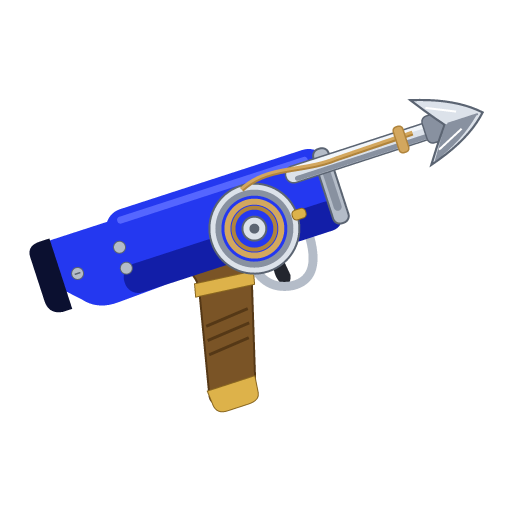

# Hookshot documentation

**We do not host, store, or distribute any game files.** This site and repository contain no ROMs, game dumps, or
decryption keys. You must supply your own supported copy and build locally on your computer.

[Get started](getting-started.md) · [Common issues](common-issues.md) · **[Report a bug](https://github.com/NotRexed/Hookshot/issues/new/choose)**

Hookshot is a static recompilation of the Switch 2 remake of *The Legend of Zelda: Ocarina of Time* for Windows
and Linux. These docs cover installation, settings, saves, troubleshooting and development.

## Guides

| You want to… | Start here |
|---|---|
| Build and launch for the first time | [Getting started](getting-started.md) |
| Understand resolution, upscaling and frame generation | [Graphics and controls](graphics-and-controls.md) |
| Find an answer to a familiar problem | [Common issues and answers](common-issues.md) |
| Update an installation or keep your progress | [Updates and saves](updates-and-saves.md) |
| Transfer a save from another compatible port | [Save transfer guide](saves.md) |
| Help diagnose a problem or contribute pipelines | [Reporting and contributing](reporting-and-contributing.md) |
| Work on the port | [Development guide](development.md) and [contribution rules](../CONTRIBUTING.md) |

## Versions

These docs follow the source branch. A setting described here may not be in the latest stable release yet. Check the
version at the top of `hookshot_log.txt` and the [release notes](https://github.com/NotRexed/Hookshot/releases) before
assuming a fix or feature is in your installation. Nightly builds are development builds.

Hookshot is experimental. The [common-issues page](common-issues.md) collects historical responses and links to
the trackers for current advice. A closed duplicate does not mean the underlying bug has been fixed.

## Project links

- [Complete reference manual](../readme.md)
- [Releases](https://github.com/NotRexed/Hookshot/releases)
- [Report a bug](https://github.com/NotRexed/Hookshot/issues/new/choose)
- [Source and contributors](https://github.com/NotRexed/Hookshot)

This is community documentation for Hookshot, an independent project. It is not affiliated with or endorsed by
Nintendo. The game, its characters and its names belong to their respective owners. No game files are distributed
with this guide.
