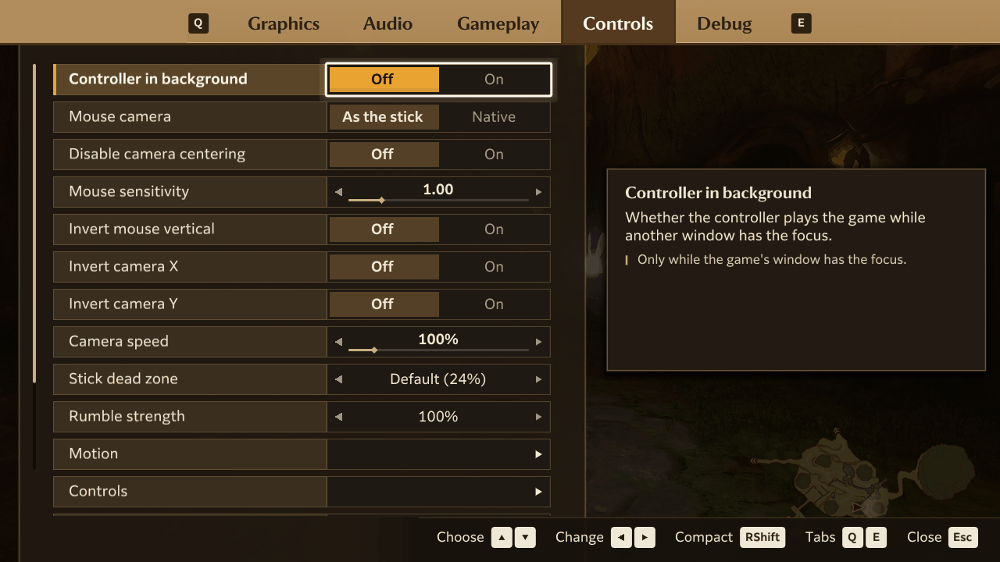

# Controls

You can play with a controller, or with the keyboard and mouse, and switch between them at any time. Every control
can be changed in the [in-game menu](settings.md).

- [Default controls](#default-controls)
- [Changing the controls](#changing-the-controls)
- [The Controls tab](#the-controls-tab)
- [Mouse](#mouse)
- [Motion controls](#motion-controls)
- [Rumble](#rumble)
- [More than one controller, and Steam Input](#more-than-one-controller-and-steam-input)
- [Writing the controls in hookshot_options.ini](#writing-the-controls-in-hookshot_optionsini)

## Default controls

The game is played as on a Switch Pro Controller. This table shows what presses each of its buttons by default.

| Switch | Keyboard and mouse | Controller |
|---|---|---|
| Left stick | <kbd>W</kbd> <kbd>A</kbd> <kbd>S</kbd> <kbd>D</kbd> | Left stick |
| Right stick (camera) | Arrow keys, or <kbd>I</kbd> <kbd>J</kbd> <kbd>K</kbd> <kbd>L</kbd>; or the mouse | Right stick |
| A | <kbd>E</kbd> | Right face button |
| B | <kbd>Shift</kbd> | Bottom face button |
| X | <kbd>Space</kbd> | Top face button |
| Y | Left mouse button | Left face button |
| L | <kbd>Q</kbd> | Left shoulder (LB, L1) |
| R | <kbd>R</kbd> | Right shoulder (RB, R1) |
| ZL | <kbd>Z</kbd> or right mouse button | Left trigger (LT, L2) |
| ZR | <kbd>X</kbd> or <kbd>F</kbd> | Right trigger (RT, R2) |
| Plus | <kbd>Tab</kbd> or <kbd>Enter</kbd> | Start, Menu or Options |
| Minus | <kbd>M</kbd> | Back, View or Share |
| Left stick press | <kbd>Ctrl</kbd> | Left stick press |
| Right stick press | <kbd>C</kbd> | Right stick press |
| D-pad left, up, right, down | <kbd>1</kbd> <kbd>2</kbd> <kbd>3</kbd> <kbd>4</kbd> | D-pad |

On the title screen, press <kbd>E</kbd> (A) to choose **New Game**.

The controller buttons go by position, as on a Switch: A is the right face button and B the bottom one, whatever
letters your controller has. To put A at the bottom, as most PC games do, change the
[layout preset](#changing-the-controls).

**Other keys:**

| Key | What it does |
|---|---|
| <kbd>Insert</kbd>, <kbd>F1</kbd> or <kbd>Esc</kbd> | Opens and closes the in-game menu |
| Right <kbd>Shift</kbd> | Switches between the full menu and its compact bar. Held while you open the menu, opens the compact bar |
| <kbd>-</kbd> and <kbd>=</kbd> | Lower and raise the mouse sensitivity |
| <kbd>F11</kbd> | Fullscreen on or off |

On a controller, open the menu with the Guide (Home) button, or Back and Start together. On a DualShock 4 or
DualSense, clicking the touchpad also opens it.

## Changing the controls



Open the in-game menu, go to the **Controls** tab, and choose **Controls**. The page that opens has two settings at the
top, then a row for each button with two columns, **Gamepad** and **Keyboard**.

**To change a control:**

1. Choose the row with <kbd>Up</kbd> and <kbd>Down</kbd>, and the column with <kbd>Left</kbd> and <kbd>Right</kbd>.
   You can also click a cell with the mouse.
2. Press <kbd>Enter</kbd> (or the controller's confirm button).
3. Press the new button or key within a few seconds.

| Key | What it does |
|---|---|
| <kbd>Esc</kbd> | Cancels while the page waits for a button, and leaves the page otherwise |
| <kbd>Delete</kbd> or <kbd>Backspace</kbd> | Clears the selected control |
| **Reset to defaults** (the last row) | Puts every control back to the defaults above |

A controller button you give to another Switch button swaps with it, so no button is left without one. A key you
give to another control is taken away from the one that had it. The movement and camera rows (**Move forward**,
**Camera up** and so on) are keyboard only. Mouse buttons can be bound to keys too.

The page saves your controls at once, in `hookshot_options.ini` in the game folder. Updates keep them.

**The two settings at the top of the page:**

| Setting | Choices | What it does |
|---|---|---|
| Layout preset | **Nintendo (Def)**, Xbox / PC, Swap Face, Custom | Where A, B, X and Y sit on the controller. **Nintendo**: as on the Switch, A right, B bottom, X top, Y left. **Xbox / PC**: A bottom, B right, X left, Y top. **Swap Face**: A bottom, B right, X and Y as on the Switch. Changing a face button yourself makes it **Custom** |
| Button prompts | **Auto**, Switch, Xbox, PlayStation 4, PlayStation 5, Steam Deck | The button icons the game shows in its texts and menus. They follow your controls, so if you move an action to another button, the icon changes with it. **Auto** uses the icons of the first controller connected, or the Switch's if the game can't tell what it is. Most of the change shows at once; a few icons change at the next start |

## The Controls tab

The rest of the Controls tab. Defaults are in bold.

| Setting | Choices | What it does |
|---|---|---|
| Controller in background | **Off**, On | On: the controller keeps playing while another window is in front, for streaming or using other apps. The keyboard and mouse always need the game's window |
| Mouse camera | **As the stick**, Native | How the mouse turns the camera (see [Mouse](#mouse)) |
| Disable camera centering | **Off**, On | On: the camera stops turning by itself toward the way you walk. Useful with **Native** mouse camera. You can still turn and recenter it yourself |
| Mouse sensitivity | 0.10 to 5.00 (**1.00**) | How far the camera turns for a mouse movement. <kbd>-</kbd> and <kbd>=</kbd> change it during play |
| Invert mouse vertical | **Off**, On | Swaps up and down for the mouse |
| Invert camera X, Invert camera Y | **Off**, On | Swaps left and right, or up and down, for the right stick |
| Camera speed | 50% to 400% (**100%**) | How fast the right stick turns the camera. It applies to the camera keys too, and to the mouse when Mouse camera is **As the stick**. The game's own camera speed setting still applies |
| Stick dead zone | **Default (24%)**, 5%, 10%, 15%, 20%, 30% | How far a stick has to move before the game notices. Lower it for a precise stick, raise it for one that drifts |
| Rumble strength | Off, 25% to 150% (**100%**) | How strongly the controller rumbles |
| Motion | | Opens the [Motion page](#motion-controls) |
| Controls | | Opens the [Controls page](#changing-the-controls) |
| Menu shortcut | Insert or F1; F1 only; **Insert, F1 or Esc** | Which keys open the in-game menu. <kbd>F1</kbd> always does. **F1 only** leaves <kbd>Insert</kbd> free for another program's overlay. Without Esc in the choice, <kbd>Esc</kbd> only lets go of the mouse |
| Compact menu key | **Right Shift**, Right Ctrl | The key that switches between the full menu and the compact bar. Held while you open the menu, it opens the compact bar directly |

## Mouse

Click in the game's window to capture the mouse; <kbd>Esc</kbd> lets it go. While it's captured, moving it turns the
camera, and its buttons count as the keys they're bound to (Y and ZL by default).

**Mouse camera** decides how it turns:

- **As the stick** (default): the mouse moves the right stick, with the stick's curve and top speed. The camera settles
  smoothly when you stop.
- **Native**: the mouse turns the camera itself, one to one, as in most PC games. **Disable camera centering** goes
  well with it.

**In the game's own menus** (Windows): the title screen and its file list, the pause menu, the Key Items, Threads of
Time and Map pages, the options and the save dialogs free the mouse while they're open. Point at an entry to select
it, left-click to choose it (A), and right-click to go back (B). The tabs, the L and R signs and the Back prompt can be
clicked too. The wheel turns the pause menu's pages and scrolls lists; on the map it changes floors and zooms. Drag with
the left button to move the map and the tapestry, or to turn a stone on Key Items. The cursor stays hidden while you
play with a controller or the keyboard, until you move the mouse.

## Motion controls

Where the game aims with motion, as on the Switch, you can aim by moving the controller. This works with a Switch Pro
Controller and controllers in Switch mode, a DualSense or a DualShock 4. With several connected, the last one you used
that has a gyroscope is the one that aims.

The **Motion** row on the Controls tab opens these settings:

| Setting | Choices | What it does |
|---|---|---|
| Motion controls | Off, **On** | Aiming by motion. The value also says whether your controller has a gyroscope ("gyro found", "no gyro on this pad", "no controller") |
| Motion sensitivity X | 10% to 600% (**100%**) | How far the aim moves left and right as you turn the controller. 100% is the console's |
| Motion sensitivity Y | 10% to 300% (**100%**) | How far the aim moves up and down as you tilt it |
| Invert motion X, Invert motion Y | **Off**, On | Turns the motion aim's left and right, or up and down, around |
| Motion deadzone | Low, **Standard**, High | How slow a movement still counts as none. **High** steadies a controller that jitters when held still; **Low** keeps the smallest movements |

## Rumble

Every controller that can rumble does, scaled by **Rumble strength**.

A Nintendo Switch Pro Controller or a single Joy-Con gets HD rumble, as on the Switch. Other controllers, Switch 2
controllers and a pair of Joy-Cons used as one controller get the game's rumble on their two motors.

- **Third-party controllers in Switch mode** (8BitDo, GameSir and others) get HD rumble too, since they report
  themselves as Switch controllers. If one rumbles weakly or not at all, add `HOS_HD_RUMBLE=0` to
  [`hookshot_env.txt`](troubleshooting.md#hookshot_envtxt) to give it the plain motor rumble.
- **On Linux**, HD rumble needs the system's SDL3 library, and read and write access to the controller's hidraw
  device. Steam's udev rules give that access; most distributions package them as `steam-devices`. Without them the
  controller gets the motor rumble.

## More than one controller, and Steam Input

All connected controllers, the keyboard and the mouse control the same player at once. There's no player 2.

The game reads controllers through SDL, which knows DualSense, DualShock 4, Switch Pro, Xbox and most other
controllers, over USB or Bluetooth. It reads Xbox-style (XInput) controllers directly only when SDL finds no
controller, so a controller that Steam Input or a similar tool presents as an Xbox controller isn't read twice.

## Writing the controls in hookshot_options.ini

<details>
<summary>For editing the file by hand</summary>

The Controls page saves each control as a line in `hookshot_options.ini`. You can also write them yourself while the
game is closed. A control the file leaves out keeps its default.

```ini
pad_a=1
key_a=69,13
```

`pad_<button>` is the controller input, by position:

| Value | Input | Value | Input |
|---|---|---|---|
| 0 | Bottom face button | 9 | Left shoulder |
| 1 | Right face button | 10 | Right shoulder |
| 2 | Left face button | 11 | D-pad up |
| 3 | Top face button | 12 | D-pad down |
| 4 | Back or Select | 13 | D-pad left |
| 5 | Guide (Home) | 14 | D-pad right |
| 6 | Start | 15 | Left trigger |
| 7 | Left stick press | 16 | Right trigger |
| 8 | Right stick press | -1 | None |

`key_<button>` is one or two
[Windows key codes](https://learn.microsoft.com/windows/win32/inputdev/virtual-key-codes) in decimal, separated by a
comma (69 is <kbd>E</kbd>, 13 is <kbd>Enter</kbd>), or 0 for none. The same codes are used on Linux. Mouse buttons
are 1 (left), 2 (right), 4 (middle), 5 and 6 (side buttons); they count while the mouse is captured.

The buttons are `a` `b` `x` `y` `l` `r` `zl` `zr` `plus` `minus` `ls` `rs` `left` `up` `right` `down`. For keys only,
there are also the movement and camera directions: `move_up` `move_down` `move_left` `move_right` `cam_up` `cam_down`
`cam_left` `cam_right`.

</details>
