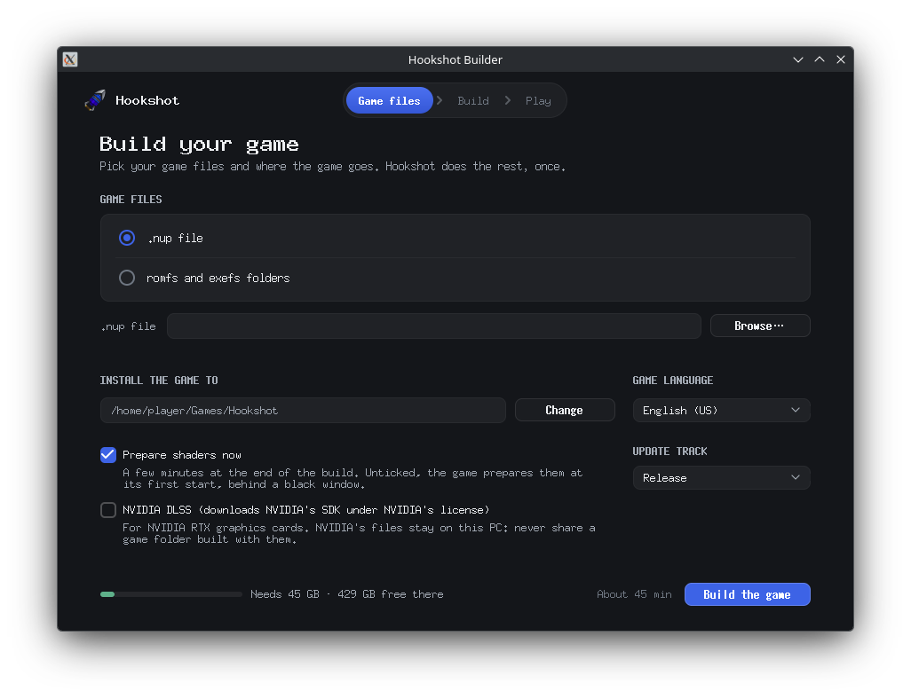

# Installing Hookshot

Hookshot doesn't come as a ready-made game. You download **Hookshot Builder**, point it at your own copy of the
game, and it builds a PC version on your machine. You do this once; after that you start and update the game from
its launcher.

- [What you need](#what-you-need)
- [Windows](#windows)
- [Linux](#linux)
- [The first start](#the-first-start)
- [Updating](#updating)
- [Where the files go](#where-the-files-go)
- [Uninstalling](#uninstalling)

## What you need

**Your copy of the game, at the supported version.** Program `0400486024DEC000` with update v131072 (build
`e0f3ccfa`). Other versions don't work. Hookshot takes either a `.nup` file or the `romfs` and `exefs` folders. A
complete dump is about 23.8 GB; see [saves](saves.md) if you want to bring a save from an emulator.

**A PC that can run it:**

| | Minimum | Notes |
|---|---|---|
| System | 64-bit Windows 10 or 11, or 64-bit Linux with glibc 2.35 or newer | Ubuntu 22.04, Debian 12, Fedora, Arch and SteamOS all work |
| CPU | x86-64 | The Linux AppImage needs AVX2. On Windows, a CPU without AVX2 gets a build made for it, a little slower |
| Graphics card | Vulkan 1.3 with mesh shaders, current driver | NVIDIA RTX 20 series or newer, AMD RX 6000 or newer, Intel Arc. Cards without mesh shaders use a slower fallback, and some models may be missing |
| Video memory | 8 GB recommended | With less, pick a lower Quality preset in the [in-game menu](settings.md) |
| RAM | 16 GB | The game uses about 10 GB |
| Disk | 45 GB free while building | An SSD is much faster. A hard drive works; the builder warns you first |

You also need an internet connection for the download. The builder brings its own compiler and tools, so there is
nothing else to install.

## Windows

1. Download `HookshotBuilder.exe` from the [latest release](https://github.com/NotRexed/Hookshot/releases/latest)
   and run it. It downloads the rest of the builder (about 500 MB), checks it, and opens.
2. Pick your game. The builder looks in your Downloads, Desktop and Documents folders and lists any `.nup` files
   under **Found on this PC**. If yours isn't there, press **Browse…**, drop the file onto the window, or choose
   **romfs and exefs folders**.
3. Check **Install the game to** (by default `Games\Hookshot` in your user folder) and **Game language**.
4. Leave the other options as they are unless you need them:

   | Option | Default | What it does |
   |---|---|---|
   | Update track | The kind of build you downloaded | Which builds you get updates from: Release, Release candidate, or Nightly (see [Updating](#updating)) |
   | Build workers, Build memory (GB) | Automatic | How many compilers run at once, and how much memory they may take. Automatic leaves room for your other programs |
   | Prepare shaders now | On | Prepares the game's shaders at the end of the build, so the first start is quick |
   | NVIDIA DLSS | Off | Downloads NVIDIA's SDK, under NVIDIA's license, for DLSS on RTX cards |
   | AMD FSR 4 | Off | Downloads AMD's runtime, under AMD's license, for FSR 4 |

5. Press **Build the game**. It takes 10 to 45 minutes depending on your CPU and memory, and you can keep using your
   PC meanwhile.
6. When it says **Your game is ready**, press **Play**. **Desktop shortcut** and **Start menu entry** are ticked by
   default; untick them if you don't want them.

<!-- screenshot: Windows builder, the form filled in (needs a Windows machine) -->

From then on, start the game from the Hookshot shortcut or `hookshot.exe` in the game folder. That's the launcher:
it has **Play**, and **Update** when there's a new version.

**Portable install.** To keep the builder, its downloads and the game together in one folder (on a USB drive or a
second SSD, say), put `HookshotBuilder.exe` in that folder and run it from a terminal as
`.\HookshotBuilder.exe --portable`. The game goes in `Hookshot` beside the builder's folder; keep both on the same
drive. Shortcuts start unticked in this mode. Details are in the
[developer guide](../dev/portable-builder.md).

## Linux

1. Download `Hookshot-<version>-x86_64.AppImage` from the
   [latest release](https://github.com/NotRexed/Hookshot/releases/latest).
2. Make it executable. In most file managers: right-click it, open **Properties**, and turn on *Allow executing file
   as program* (the wording varies). Or in a terminal:

   ```sh
   chmod +x Hookshot-*-x86_64.AppImage
   ```

3. Double-click it. The builder opens.
4. Under **Game files**, choose **.nup file** or **romfs and exefs folders**, and pick them with **Browse**.
5. Check **Install the game to** (by default `~/Games/Hookshot`) and **Game language**. The **Update track**,
   **Prepare shaders now** and **NVIDIA DLSS** options work as on Windows (see the table above).
6. Press **Build the game**. It takes 10 to 45 minutes.
7. When it says **Your game is ready**, press **Play**.



The game is added to your applications menu as **Hookshot**. That entry, and `hookshot` in the game folder, open the
launcher. **Keep the AppImage where it is**: the launcher uses it to update.

On AMD cards, the game is faster with access to `/dev/udmabuf`. If the log warns about it, see
[troubleshooting](troubleshooting.md#linux-udmabuf-warning). NVIDIA users can ignore that warning.

To build or run without the window (over SSH, or from a script), see the
[developer guide](../dev/running.md).

## The first start

With **Prepare shaders now** on, the build has already prepared the shaders and the game starts in a few seconds.
If you turned it off, the first start prepares them behind a black window, which takes a few minutes.

The first time you visit a place, you may see a short stutter while the graphics card finishes setting up what it
draws there. Visiting the same place again is smooth.

The [in-game menu](settings.md) opens with **Esc**, **Insert** or **F1**. On a controller, press the Guide (Home)
button, or Back and Start together; on a PlayStation controller, click the touchpad.

## Updating

When there's a new version, the launcher shows **Update**. Press it: the launcher downloads only what changed and
rebuilds the game in the same folder. This takes about as long as the first build. Your saves, settings and mods are
kept.

| Kept | Replaced |
|---|---|
| Your saves | The game itself (`bin`, `image.bin`, the shader list) |
| `hookshot_options.ini`: menu settings and controls | |
| `hookshot_env.txt` | |
| `language.txt`: the game language you set | |
| The `mods` folder | |

Your original game files are kept in the game folder, so you don't need the `.nup` again. It's still a good idea to
copy your saves somewhere before updating (see [Where the files go](#where-the-files-go)).

**Update tracks.** The builder's **Update track** decides what the launcher offers:

- **Release**: tested releases. The right choice for most players.
- **Release candidate**: the next release while it's being tested.
- **Nightly**: built from the latest code after every change. Untested; it may break your saves or settings, so back
  them up first.

To go back to a release, switch the track to **Release** and update, or install the
[latest release](https://github.com/NotRexed/Hookshot/releases/latest) again.

What changed in each version is on the [releases page](https://github.com/NotRexed/Hookshot/releases).

## Where the files go

| What | Windows | Linux |
|---|---|---|
| The game | The folder you chose (`%USERPROFILE%\Games\Hookshot`) | The folder you chose (`~/Games/Hookshot`) |
| Saves | `user` in the game folder | `~/.local/share/hookshot` |
| Settings | `hookshot_options.ini` in the game folder | `hookshot_options.ini` in the game folder |
| Log of the last run | `hookshot_log.txt` in the game folder | `hookshot_log.txt` in the game folder |
| The builder and its tools | `%LOCALAPPDATA%\HookshotBuilder` | `~/.cache/hookshot-builder` |

The build reads your game and never changes it. Its temporary files (about 4 GB) are deleted when the game is ready.

## Uninstalling

Delete the game folder, the builder's folder (see the table above) and the shortcuts. Copy your saves first if you
want to keep them.
