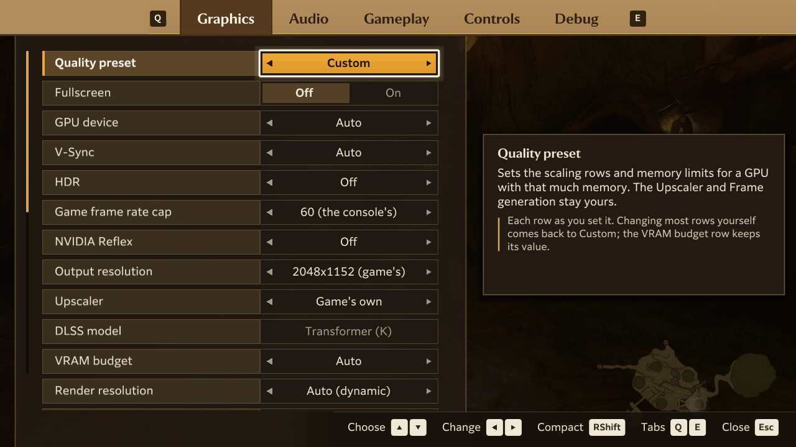
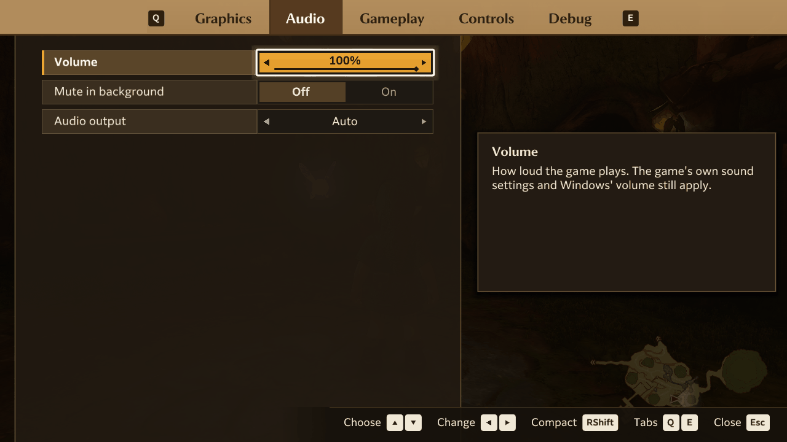
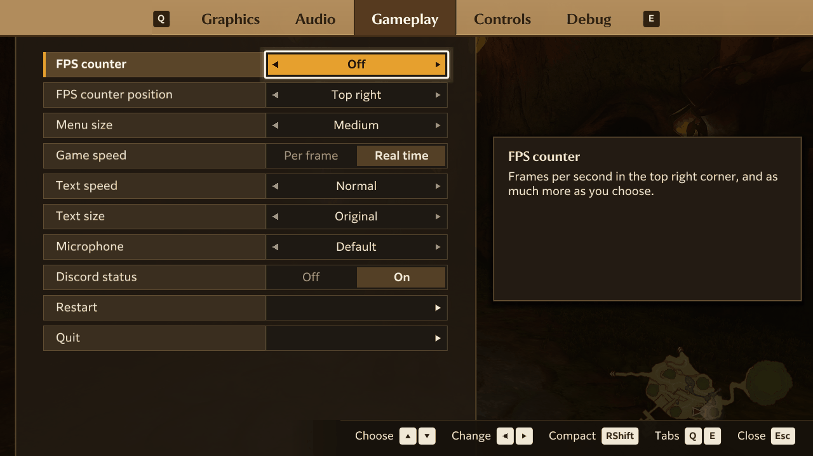
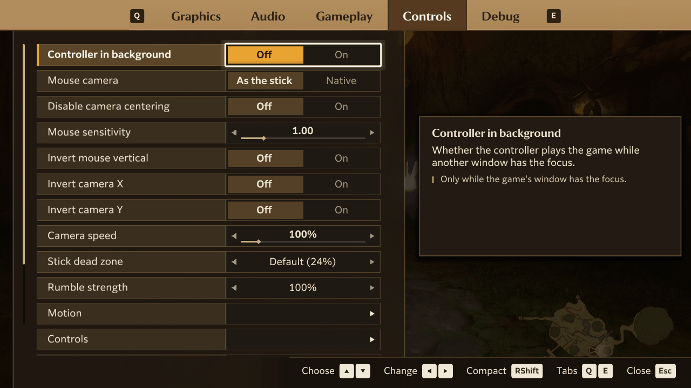
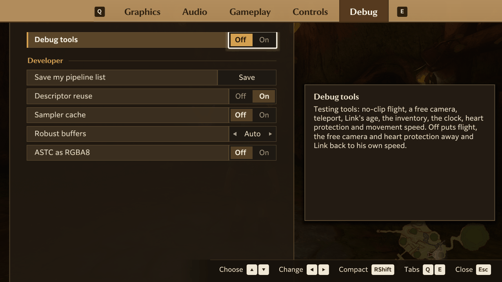

# Settings

Hookshot has its own settings menu on top of the game. It covers graphics, sound, controls and a few gameplay
comforts. The game's own options, in its pause menu, still work as on the Switch.

- [Using the menu](#using-the-menu)
- [Quality presets](#quality-presets)
- [Graphics](#graphics)
- [Audio](#audio)
- [Gameplay](#gameplay)
- [Controls](#controls)
- [Debug](#debug)

## Using the menu

**Opening it.** Press **Insert**, **F1** or **Esc** while playing. On a controller, press the Guide (Home) button, or
Back and Start together; on a PlayStation controller, click the touchpad. The same buttons close it again. **F1**
always works; the [Menu shortcut](#controls) row can leave Esc out, or make it F1 only so Insert stays free for another
overlay.

**Moving around.**

| | Keyboard | Controller |
|---|---|---|
| Choose a row | Up and Down | D-pad up and down |
| Change a value | Left and Right, or Enter | D-pad left and right |
| Open a page (Motion, Controls, Teleport, Inventory) | Enter | A |
| Switch tabs | Q and E, or Tab and Shift+Tab | The shoulder buttons or triggers |
| Go back, or close | Esc | B |

A and B are the buttons your controller layout puts the Switch's A and B on. The mouse works too: click a tab or a row,
click the left or right half of a value to lower or raise it, drag a slider, scroll with the wheel, and right-click to
go back. The prompts along the bottom show the keys or buttons for whatever you used last.

Beside the list, a help box says what the selected row does and, underneath, what the chosen value does.

**The compact bar.** Press **Right Shift** while the menu is open to shrink it to a bar at the bottom of the screen
that shows one setting at a time, so you can see the game while you adjust it. Press it again for the full menu. Hold
it while you open the menu to go straight to the bar. The [Compact menu key](#controls) row can make it Right Ctrl.

**Where settings are kept.** Every change is saved at once to `hookshot_options.ini` in the game folder. Updates keep
this file.

**Rows that need a restart.** Some rows only take effect when the game starts. When one is selected, the help box
says **Takes effect after a restart**. Once you change it, a small gold diamond appears beside its name, and the
Graphics and Debug tabs list it under **Restart needed**. When you close the menu, it asks whether to restart now:
**Later** keeps the change for the next start, **Restart Now** starts the game again straight away. Save your progress
first, because anything since your last save is lost. In the tables below, these rows say "Applies after a restart".

**Rows you may not see.** The menu hides rows that your PC can't use. NVIDIA Reflex, AMD Anti-Lag 2 and the DLSS
model appear only on graphics cards that support them, the HDR brightness rows appear only while HDR is on, and the HDR tone mapper only with HDR set to Native.

## Quality presets

The **Quality preset** row, at the top of the Graphics tab, sets several rows at once for a graphics card with a given
amount of video memory. Pick the one that matches your card, then adjust from there.

| Preset | Render resolution | Window scaling filter | Sharpness | Profile | VRAM budget |
|---|---|---|---|---|---|
| Minimum (4GB) | 50% | Lanczos | 30% | Handheld | 2.2 GB |
| Low (6GB) | 75% | Lanczos | 30% | Handheld | 3.6 GB |
| Balanced (8GB) | 100% | Catmull-Rom | 30% | Docked | 4.8 GB |
| High (12GB) | 100% | Lanczos | 40% | Docked | 7.5 GB |
| Ultra (16GB+) | 100% | Lanczos | 50% | Docked | 11 GB |

Every preset also turns **Frame pacing** on and sets **Game speed** to Real time. A preset never changes the
**Upscaler** or **Frame generation**. With DLSS or FSR chosen, the Render resolution moves to the nearest step that
upscaler has.

**Custom** leaves every row as you set it. Changing the Upscaler, Render resolution, Frame pacing, Window scaling
filter, Sharpness, Profile or Game speed yourself switches the preset to Custom, but keeps the preset's video memory
limit. Other rows don't affect the preset.

The first time you start the game, Hookshot picks a preset for your card: **Minimum (4GB)** on integrated graphics or
a card with about 4 GB, **Low (6GB)** on a card with about 6 GB, and **Custom** otherwise. On those small cards it
keeps the Docked profile, and Minimum starts with the scaling filter and sharpness off.

On **Minimum (4GB)**, when your graphics driver gives the game 4.5 GB of video memory or less, large textures also
load at a lower resolution, to fit. Other presets keep full texture detail.

## Graphics

For more on the Upscaler, Render resolution and Frame generation, and how to pick between them, see
[upscaling](upscaling.md).

The tab groups its rows under headings, in this order: Resolution and upscaling, Frame generation and latency,
Screen, HDR, Detail, and GPU and memory (the rows to change when something is wrong).

| Setting | Choices | Default | What it does |
|---|---|---|---|
| Quality preset | Custom, Minimum (4GB), Low (6GB), Balanced (8GB), High (12GB), Ultra (16GB+) | Custom | Sets the scaling rows and the video memory limit for a card with that much memory. See [Quality presets](#quality-presets) |

**Resolution and upscaling**

| Setting | Choices | Default | What it does |
|---|---|---|---|
| Output resolution | 1920x1080, 2048x1152 (game's), 2560x1440, 3840x2160, 5120x1440, 5120x2880 | 2048x1152 (game's) | The size of the game's whole picture, menus and HUD included, before it's fitted to your window. Pick your screen's size for the sharpest result. Docked profile only. Applies after a restart |
| Profile | Docked, Handheld | Docked | Runs the game as the Switch does when docked, or in handheld mode. **Handheld** draws at 1536x864, softer but lighter on the card. Applies after a restart |
| Upscaler | Game's own, NVIDIA DLSS, AMD FSR 3.1, AMD FSR 4, Off (no upscaling) | Game's own | What enlarges the 3D scene to the output resolution. **Game's own** is the Switch's upscaler. **NVIDIA DLSS** needs an NVIDIA RTX card and a build with DLSS. **AMD FSR 3.1** runs on most cards. **AMD FSR 4** needs a supported AMD card and a build with FSR 4. **Off** just stretches the scene: fastest, but rough edges. Only choices your PC can run appear |
| DLSS model | Transformer (K), Transformer 2 (M), Transformer 2 (L), NVIDIA default | Transformer (K) | Which version of DLSS draws the picture. **K** is the most tested; **M** is sharper for a little more GPU time; **L** suits the lowest render resolutions; **NVIDIA default** lets the driver choose. Shown only where DLSS runs |
| Render resolution | Depends on the Upscaler (see below) | Auto (dynamic) | The size the 3D scene is drawn at, as a share of the output. The Upscaler fills in the rest. Lower is faster and softer. **Auto** lets the game lower it when the card is busy, as on the Switch |
| Sharpness | 0% to 100%, in steps of 10 | 0% | Sharpens the picture as it goes to the window. Too much leaves halos around edges. DLSS looks softer than the game's own upscaler, so around 80% suits it |

**Frame generation and latency**

| Setting | Choices | Default | What it does |
|---|---|---|---|
| Frame generation | Off, Auto, 2x to 8x | Off | Adds frames between the game's own for smoother motion, at a little extra input delay. Fast motion and camera cuts can show flaws. **Auto** adds only as many as your display's refresh rate needs. **2x** adds one frame between each pair, **3x** two, and so on |
| Frame generation by | Auto, Built-in | Auto | Who makes the extra frames at 2x and above. **Auto** uses NVIDIA DLSS Frame Generation on an RTX 40 series or newer card while DLSS, FSR 3.1 or FSR 4 is the Upscaler, and Hookshot's built-in generator otherwise. **Built-in** always uses Hookshot's. Changes at once |
| Frame pacing | Off, On | Off | **On** shows frames at an even interval: less stutter, with up to one frame of extra delay. **Off** shows each one as soon as it's ready |
| Game frame rate cap | 60 (the console's), 90, 120, 144, 165, 240, Uncapped | 60 (the console's) | The most frames the game itself draws each second. Frame generation adds frames on top. Above 60 is experimental: the game keeps the right speed, but some cutscenes and bosses (such as Gohma) can misbehave. **Uncapped** runs as fast as your PC can, still limited by the display with V-Sync on. Applies after a restart |
| NVIDIA Reflex | Off, On, On + Boost | Off | Lowers input delay by starting each frame as late as possible. **On + Boost** also keeps the card's clocks up. Works with frame generation. Shown only on NVIDIA cards whose driver supports it |
| AMD Anti-Lag 2 | Off, On | Off | Lowers input delay by starting each frame as late as possible. Not used while frame generation is on. Shown only on AMD cards whose driver supports it |

**Screen**

| Setting | Choices | Default | What it does |
|---|---|---|---|
| Fullscreen | Off, On | Off | Fills the whole screen with the game, without a window border. **F11** does the same |
| V-Sync | Auto, On, Off | Auto | Whether each frame waits for the display's refresh. **Auto** avoids tearing without the wait where the driver allows it. **On** never tears, and runs at most at the display's rate. **Off** has the least delay but can tear. Changes at once |
| Window scaling filter | Off, Catmull-Rom, Lanczos | Off | How the finished picture is fitted to your window when their sizes differ. **Catmull-Rom** is sharper than Off; **Lanczos** sharper still, but can ring around edges. Shows *Not needed* when the window already matches the output resolution |
| Aspect ratio | 16:9, Monitor's shape | Monitor's shape | **Monitor's shape** widens or narrows the view to fit a screen that isn't 16:9, such as 21:9, 32:9, 4:3 or 16:10; the HUD stays in the middle 16:9. **16:9** keeps the game's own shape. Applies after a restart |
| Ultrawide menus | Full width; Centred, blurred sides; Centred, black bars | Centred, blurred sides | With the Aspect ratio at Monitor's shape, how the pause, item and map menus fill a wide screen: stretched across it, in the middle with the game blurred at the sides, or in the middle with black bars. Loading screens and movies get the same sides. Changes at once |

**HDR**

| Setting | Choices | Default | What it does |
|---|---|---|---|
| HDR | Off, Expanded, Native (the game's) | Off | HDR output on an HDR display. On Windows, turn on **Use HDR** in the display settings first. **Expanded** brightens the normal picture into HDR. **Native** uses the game's own HDR |
| HDR paper white | 80 to 400 nits, in steps of 10 | 200 nits | How bright white looks with HDR on. Around 200 suits a normal room; go higher in a bright one. Shown only with HDR on |
| HDR peak brightness | 400 to 4000 nits, in steps of 100 | 1000 nits | The brightest highlights with HDR on. Set it to your display's peak brightness. Shown only with HDR on |
| HDR contrast | 50% to 200%, in steps of 5 | 100% | Above 100%, deeper shadows and brighter highlights; below, a flatter picture. Works with both Expanded and Native. Shown only with HDR on |
| HDR tone mapper | Vanilla, PsychoV35 | Vanilla | With HDR set to Native, how the scene's brightness fits your display. **Vanilla** is the game's own curve. **PsychoV35** (from RenoDX) keeps the same mid-grey and lets highlights roll off into the peak brightness with their colour kept. DLSS, FSR and the game's TAAU don't use it yet |

**Detail**

| Setting | Choices | Default | What it does |
|---|---|---|---|
| Anisotropic filtering | Game's, 2x, 4x, 8x, 16x | 16x | Keeps textures sharp on surfaces seen at an angle, such as the ground ahead. **Game's** is the Switch's own, which is blurrier |

**GPU and memory**

| Setting | Choices | Default | What it does |
|---|---|---|---|
| GPU device | Auto, or each graphics card by name | Auto | Which graphics card runs the game, for PCs with more than one. Auto picks the best dedicated card. Applies after a restart |
| VRAM budget | Auto, 3.6 GB, 4.8 GB, 6 GB, 7.5 GB, 9 GB, 11 GB | Auto | How much video memory the game's textures may use. Lower it if the game stutters after you've played a while. A preset sets it; the Minimum preset uses 2.2 GB |
| Mesh shaders | Automatic, Native, Compute | Automatic | How the card draws much of the scenery. **Automatic** uses the card's mesh shaders where it has them. **Compute** works on every card and is usually a little slower; try it if objects are missing or the game crashes. Applies after a restart |

**Render resolution choices.** The steps depend on the Upscaler. Each shows the size it draws at.

| Upscaler | Render resolution steps |
|---|---|
| Game's own | Auto, 100%, 75%, 67%, 50% |
| NVIDIA DLSS, AMD FSR 4 | Auto, Native, 92%, 83%, 75%, Quality (67%), Balanced (58%), Performance (50%), Ultra Performance (33%) |
| AMD FSR 3.1 | Auto, 100%, 92%, 83%, 75%, Quality (67%), Balanced (58%), Performance (50%), Ultra Performance (33%) |
| Off | Auto, 100%, 75%, 67%, 50%, 33% |

**Native** draws the scene at full size and uses the upscaler only to smooth edges: with DLSS this is DLAA, with
FSR 4 its Native AA. It's the sharpest and the heaviest choice. At 100%, FSR 3.1 does the same.

## Audio

| Setting | Choices | Default | What it does |
|---|---|---|---|
| Volume | 0% to 100%, in steps of 5 | 100% | How loud the game plays. The game's own sound settings and your system volume still apply |
| Mute in background | Off, On | Off | Silences the game while another window is in front. The sound comes back when you switch to the game |
| Audio output | Auto, Stereo, 5.1 | Auto | The speakers the game mixes for. **Auto** picks 5.1 when your default output device has 5.1 or more speakers, and stereo otherwise. **5.1** on stereo speakers is mixed down. Applies after a restart |

## Gameplay

| Setting | Choices | Default | What it does |
|---|---|---|---|
| FPS counter | Off, FPS, Frame time, Graph, Breakdown | Off | Shows the frame rate on screen, with as much detail as you choose. **FPS** is the frame rate, plus the game's own rate with frame generation on. **Frame time** adds the time per frame and the 1% low (the slowest frames of the last 10 seconds). **Graph** adds a graph of the last 4 seconds, with a line at the frame rate cap. **Breakdown** adds where each frame's time goes, and marks when shaders were being prepared |
| FPS counter position | Top right, Top left, Bottom right, Bottom left | Top right | The corner the FPS counter sits in. While the menu is open it shows at the top right |
| Menu size | Small, Medium, Large | Medium | How large this menu, the FPS counter and the start-up screen are. **Small** suits a desk, **Large** a TV across the room |
| Game speed | Per frame, Real time | Real time | How the game keeps time when it runs below 60 fps. **Real time** keeps normal speed down to 15 fps. **Per frame** slows the game down whenever the frame rate drops |
| Field of view | 50% to 150%, in steps of 5 | 100% | How much of the world you see. 100% is the game's own view; higher is wider, lower is closer. Changes at once during gameplay. Cutscenes, the HUD and movies keep their own view |
| Text speed | Normal, 2x, 4x, Instant | Normal | How fast dialogue and other messages print. **Instant** shows each page at once |
| Text size | Original, 110%, 125%, 150%, 175% | Original | How large dialogue, Navi's text and signs are drawn |
| Microphone | Off, Default, or each microphone by name | Default | What the game hears when you use its microphone option (playing an instrument or humming). **Default** is your system's recording device. On Windows, desktop apps must be allowed to use the microphone (Settings, Privacy & security). An unplugged microphone stays chosen, and Default stands in until it's back |
| Discord status | Off, On | On | Shows "Playing Hookshot" and your play time in your Discord status, while Discord runs on this PC |
| Restart | | | Starts the game again. Press Enter or A twice to confirm; Esc or B cancels. Save first |
| Quit | | | Closes the game. Press Enter or A twice to confirm; Esc or B cancels. Save first |

## Controls

Setting up buttons and keys is covered in [controls](controls.md).

| Setting | Choices | Default | What it does |
|---|---|---|---|
| Controller in background | Off, On | Off | **On** lets the controller play the game while another window is in front, for streaming or other apps. The keyboard and mouse always need the game's window |
| Mouse camera | As the stick, Native | As the stick | How the mouse turns the camera. **As the stick** treats the mouse like the right stick. **Native** turns the camera directly, one to one, as in a PC game |
| Disable camera centering | Off, On | Off | **On** stops the camera slowly swinging round behind you as you move. Useful with Native mouse camera. Manual camera control and recentering still work |
| Mouse sensitivity | 0.10 to 5.00, in steps of 0.10 | 1.00 | How far the camera turns for a mouse movement, with either mouse camera. The **-** and **=** keys change it while playing |
| Invert mouse vertical | Off, On | Off | Swaps up and down for the mouse |
| Invert camera X | Off, On | Off | Swaps left and right for the right stick |
| Invert camera Y | Off, On | Off | Swaps up and down for the right stick |
| Camera speed | 50% to 400%, in steps of 25 | 100% | How fast the right stick turns the camera, compared with the game's own speed. Also applies to the camera keys, and to the mouse with **As the stick**. The game's own camera speed option still applies |
| Stick dead zone | Default (24%), 5%, 10%, 15%, 20%, 30% | Default (24%) | How far a stick must move before the game notices. Lower suits a precise stick, higher one that drifts. The game's own dead zone still applies on top |
| Rumble strength | Off, 25% to 150%, in steps of 25 | 100% | How strongly the controller rumbles, compared with the game's own |
| Motion | | | Opens the Motion page (below) |
| Controls | | | Opens the Controls page: the layout preset, the button prompts, and which button and keys press each of the Switch's buttons |
| Menu shortcut | Insert or F1; F1 only; Insert, F1 or Esc | Insert, F1 or Esc | Which keys open and close this menu. F1 always does. **F1 only** leaves Insert free for another overlay. While the menu is open, Esc always goes back a page or closes it |
| Compact menu key | Right Shift, Right Ctrl | Right Shift | The key that switches between the full menu and the [compact bar](#using-the-menu) |

### The Motion page

Motion controls aim with the controller's gyroscope wherever the game uses motion, as on the Switch. They work with
Switch Pro controllers and pads in Switch mode, DualSense and DualShock 4.

| Setting | Choices | Default | What it does |
|---|---|---|---|
| Motion controls | Off, On | On | Aiming with the controller's gyroscope. The value also says whether the connected controller has one |
| Motion sensitivity X | 10% to 600%, in steps of 10 | 100% | How far the aim moves left and right as you turn the controller. 100% is the Switch's |
| Motion sensitivity Y | 10% to 300%, in steps of 10 | 100% | How far the aim moves up and down as you tilt the controller. 100% is the Switch's |
| Invert motion X | Off, On | Off | Swaps left and right for motion aiming |
| Invert motion Y | Off, On | Off | Swaps up and down for motion aiming |
| Motion deadzone | Low, Standard, High | Standard | How slow a movement counts as none. **High** steadies a controller that jitters when held still; **Low** keeps the smallest movements. Standard is the Switch's |

### The Controls page

These two rows sit above the button grid on the Controls page.

| Setting | Choices | Default | What it does |
|---|---|---|---|
| Layout preset | Nintendo, Xbox / PC, Swap Face, Custom | Nintendo | Which face button is which. **Nintendo** is the Switch's order. **Xbox / PC** puts A at the bottom and B on the right. **Swap Face** swaps only A and B. Binding a button yourself makes it **Custom** |
| Button prompts | Auto, Switch, Xbox, PlayStation 4, PlayStation 5, Steam Deck | Auto | The button icons the game shows in its text and menus. **Auto** follows your first controller, and shows Switch icons when it can't tell. Applies after a restart |

## Debug

The debug tools are testing aids: they let you fly, move the camera freely, jump between places, switch Link's age,
edit the inventory and set the clock. They're off by default. Turn on **Debug tools** to show them; turning it off
puts away flight, the free camera and heart protection, and returns Link to his normal speed.

| Setting | Choices | Default | What it does |
|---|---|---|---|
| Debug tools | Off, On | Off | Shows the tools below |

**Player**

| Tool | What it does |
|---|---|
| Heart protection | Link doesn't lose hearts. Hits can still knock him back |
| No-clip flight | Double-tap Jump to take off and to land. Hold Jump to climb, L to descend |
| Movement speed | How fast Link walks, runs and swims: 1x, 1.25x, 1.5x, 2x or 3x his normal speed |
| Switch age | Swaps Link between child and adult and reloads the area in the other age (or the Market, when the area has no match) |
| Inventory | Opens the inventory editor: unlock or remove equipment, items, upgrades and quest items, and change amounts |

**Travel**

| Tool | What it does |
|---|---|
| Teleport | Opens a list of areas. Link travels there through the game's own area change, at his current age |
| Mark position | Remembers where Link stands in the current area |
| Return to mark | Moves Link back to the marked position in the current area |

**Camera & world**

| Tool | What it does |
|---|---|
| Free camera | Detaches the camera. Move and look with your usual controls; Page Up and Page Down, or R and L, change its height |
| Set time | Choose an hour with Left and Right, then press Enter to set the clock |

### Developer

These rows are for troubleshooting, usually when someone helping you with a problem asks you to change one. Leave
them as they are otherwise. All of them apply after a restart.

| Setting | Choices | Default | What it does |
|---|---|---|---|
| Descriptor reuse | Off, On | On | A rendering shortcut that reduces stutter while the game streams textures |
| Sampler cache | Off, On | Off | A rendering shortcut that can help while the game streams textures |
| Save my pipeline list | (an action) | | Saves the pipelines your play built, with a report, as a zip in Downloads, for the "Submit your pipelines" issue. Helps remove first-visit stutter for everyone. See [send your pipeline list](troubleshooting.md#send-your-pipeline-list) |
| Robust buffers | Auto, Off, On | Auto | Guards the graphics card against out-of-range reads. **Auto** is on for every card. **Off** can be faster on some NVIDIA cards |
| ASTC as RGBA8 | Off, On | Off | A workaround for broken or blocky textures seen on some AMD cards. Uses far more video memory. See [troubleshooting](troubleshooting.md) |
