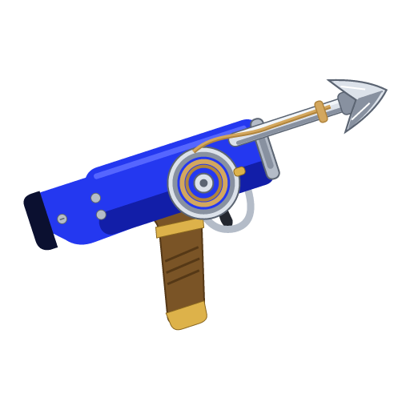

<h1 align="center">
   
  

   
  <b>Hookshot</b>
   
</h1>

<h4 align="center">The Legend of Zelda: Ocarina of Time (Nintendo Switch 2) running natively on Windows & Linux, with no emulator.
</h4>

  <a href="docs/user/install.md">Install</a> |
  <a href="docs/user/settings.md">Settings</a> |
  <a href="docs/user/troubleshooting.md">Problems</a> |
  <a href="#documentation">Documentation</a> |
  <a href="#want-to-help">Want to help?</a> |
  <a href="#credits">Credits</a> |
  <a href="#license">License</a>

Hookshot is a static recompilation. The game's code is translated to C and compiled into a Windows or Linux program,
the console's system software is reimplemented, and the Switch 2 graphics are rebuilt on Vulkan. All of this happens
**on your PC, from your own copy of the game**.
 

> [!WARNING]
> Some users report the file in releases to be a Trojan - it is not. Feel free to run it through any antivirus software

Discord: https://discord.gg/rexed
 

> [!IMPORTANT]
> This repository **does not contain the game, keys or an executable**, and it does not explain how to get them. You
> need your own copy. Everything the build creates (`hookshot.exe`, the generated code, the shader caches and your
> saves) comes from your game and stays on your PC. Never share those files.

## Project status

Playable, and still experimental. The whole game can be reached, with open bugs along the way.

- **Works:** gameplay, sound, saves, controllers, keyboard and mouse, the settings menu, upscaling (DLSS, FSR) and
  frame generation, on Windows and Linux.
- **Rough edges:** a short stutter the first time you visit a place; performance depends on the PC, with Hyrule
  Field the most demanding; some areas have open graphics bugs or crashes.
- **Graphics cards:** NVIDIA is the most tested. AMD works, with some reported crashes. Intel has few reports, many of
  them problems. Cards without mesh shaders run a slower fallback.

What players have tested is in [tested configurations](docs/tested-configurations.md). Known bugs are on the
[issue tracker](https://github.com/NotRexed/Hookshot/issues).

## Getting started

1. Get your own copy of the game at the supported version (program `0400486024DEC000`, update v131072).
2. Download Hookshot Builder from the [latest release](https://github.com/NotRexed/Hookshot/releases/latest):
   `HookshotBuilder.exe` on Windows, the `.AppImage` on Linux.
3. Point it at your game and press **Build the game**.

The full steps and the system requirements are in the [install guide](docs/user/install.md).

## Documentation

**Playing**

- [Installing and updating](docs/user/install.md)
- [Settings](docs/user/settings.md): every option in the in-game menu
- [Upscaling, frame generation and latency](docs/user/upscaling.md)
- [Controls](docs/user/controls.md)
- [Saves](docs/user/saves.md), including saves from emulators
- [Mods](docs/user/mods.md)
- [Troubleshooting](docs/user/troubleshooting.md)

**Developing**

- [Developer documentation](docs/dev/README.md): building, running, switches, architecture, testing, releasing
- [Contributing](CONTRIBUTING.md)

## How it works

1. `nx2/lift.py` translates the game's ARM64 code to C.
2. `nx2/build.py` compiles that C together with `host/`, which plays the part of the console's system.
3. `host/nvn_native.c` records the game's NVN2 graphics calls, and `gpu/vk/` replays them on Vulkan.
4. Switch 2 Ampere shaders are lowered to Maxwell (`lower_to_maxwell.h`) and translated to SPIR-V by Eden's shader
   recompiler.

More detail is in the [architecture guide](docs/dev/architecture.md).

## Want to help?

Testing on other graphics cards and reporting the result already helps a lot, and so does playing further into the
game than anyone has yet.

Bigger ways to help:

- **Linux testing.** The Linux build (`host/posix`) has been tested on several distributions and cards: reports from
  others still help.
- **Fixes in your own fork.** Fork the project, fix what you find and send the change back. Keep game files, keys and
  anything generated from your game out of it.

[CONTRIBUTING.md](CONTRIBUTING.md) has the setup, the test commands, the code conventions and what a good pull request
looks like.

## Credits

Hookshot exists thanks to the work of many people:

- **NotRexed**: Hookshot, BlueShell (Mario Kart World), Skybound (Tears of the Kingdom) and the a64-kit tools.
- **[Eden](https://git.eden-emu.dev/eden-emu/eden)** and **Eglantine**: the shader recompiler and Switch 2 shader work.
- **suyu**: the graphics decoders and the AArch64 translator.
- **[seedds/nxnative](https://github.com/seedds/nxnative)**: reference for how task and mesh shaders work.
- **[EvilBoyce / evilmfkr](https://github.com/evilmfkr/Hookshot)** (EvilOOT): the GPU culling that brings back Kokiri's foliage
  (trees, ferns, grass, falling leaves, fireflies), the ambient light probes, the pond's water, the game's own fog, the freeze
  after Load (Horizon's mutex handoff) and the exposure flicker fix.
- **[zortos293/Lichii](https://github.com/zortos293/Lichii)**: reference for Ampere shader lowering, and its compare-exchange retry fix.
- **[mstorsjo/llvm-mingw](https://github.com/mstorsjo/llvm-mingw)**: the bundled Windows compiler (no Visual Studio needed).
- **NVIDIA DLSS**: builds made with NVIDIA's DLSS SDK (optional, downloaded by each build, never bundled) use NVIDIA DLSS
  Super Resolution, NVIDIA's technology. NVIDIA and DLSS are trademarks of NVIDIA Corporation.
- **AMD FSR 3.1 and FSR 4**: every build has AMD FidelityFX Super Resolution 3.1, built from AMD's MIT-licensed FidelityFX
  SDK shaders; builds made with FSR 4 (optional; AMD's DLLs are never bundled) use AMD FidelityFX Super Resolution 4
  through AMD's MIT-licensed FSR API headers. Both are AMD's technology. AMD, Radeon and FidelityFX are trademarks of Advanced Micro
  Devices, Inc.
- **[kinnay/zbic](https://github.com/kinnay/zbic)**, **Opus** and **SDL**: decompression, audio and controllers.
- **[sostenesfreitas/ocarina-recomp](https://github.com/sostenesfreitas/ocarina-recomp)**: this README's layout, and its notes
  confirmed the mesh stage's control section.
- **[MythosOfs/Orchid](https://github.com/MythosOfs/Orchid)**: the fog and exposure workaround Ocarina of Time used before
  its fog and lighting were fixed.
- **Mesa (NAK)**: the reference for Ampere's instruction encoding.
- Everyone who sent fixes: SkippySteve (Linux and the AppImage, and many more), monsterlag, klimovich008, hckrman101 (NVIDIA
  DLSS, DLAA and Reflex, the exposure flicker and fog fixes, build speed, CI), madebyjordan (AMD FSR 4.1), N3oTraX (FSR 4 on
  Linux), shayderrr, gab9281, Wpaif, nicholasgower, ZurielAtr, Joey-Magnus, Zorkats,
  d3zessete, chrispository, vzeol, leonidasmark, Segmentree, ShyVortex, hiKareeem and i900gaming, among others.

## License

Hookshot is free software under the [GNU General Public License, version 3 or later](LICENSE) (GPL-3.0-or-later).
It includes code from Eden and suyu, which are under the GPL too. Third-party parts under other licenses that
work with the GPL (Sirit, the Vulkan Memory Allocator, SDL, Opus, Dear ImGui, zstd, the Libertinus fonts, zbic and the
a64-kit tools) keep their own notices in their folders.

Hookshot is an unofficial fan project, not affiliated with or endorsed by Nintendo. The Legend of Zelda and Ocarina of
Time are trademarks of Nintendo.
